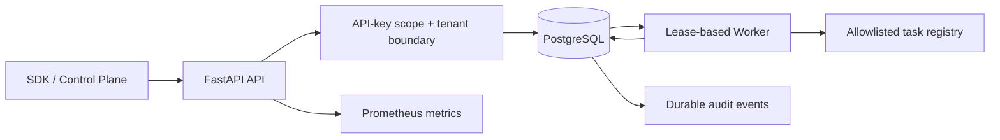

# QueueForge Nexus — Architecture

## Design goal

QueueForge Nexus demonstrates the correctness boundaries of a durable background-job control plane: request validation, persistent job state, worker leases, attempt fencing, retries, and dependency-aware workflows. It is a portfolio MVP; the current execution model is at-least-once, not exactly-once.

## Components



- **API:** Pydantic contracts, tenant-derived authorization, request size boundary, idempotency conflict checks, API key scopes, readiness/liveness checks and request correlation IDs.
- **Persistence:** PostgreSQL is the reference store in Compose. Alembic migrations own schema changes. Job and audit writes are committed together.
- **Claim protocol:** PostgreSQL row locks with `SKIP LOCKED` allow multiple worker processes to claim different jobs. Job state transitions and attempts are persisted.
- **Lease + fencing:** A worker renews a lease while executing. Completion verifies the worker ID and attempt number, preventing a reclaimed stale attempt from overwriting a newer one. A task with external side effects must itself be idempotent; a queue cannot guarantee exactly-once side effects by itself.
- **Retry policy:** Retryable failures return to queued state with capped exponential delay. Permanent task failures or exhausted attempts become dead-letter jobs.
- **Workflow orchestration:** Graph validation rejects unknown nodes, duplicate edges, self-links, and cycles. Workflow runs keep a graph snapshot and enqueue children after all parents succeed.
- **Observability:** Request counters and latency histogram use low-cardinality route templates. `/api/metrics` requires platform `admin` scope because it exposes service-wide aggregates; tenant-scoped `audit:read` is not sufficient. Metrics intentionally omit tenant IDs and job IDs as labels. The `workers:read` scope is treated as system-wide and can only be granted by an existing platform administrator.

## Consistency and failure cases

| Case | Expected behavior | Evidence to run |
|---|---|---|
| Client times out after create | Retry same idempotency key and identical request | `test_create_list_detail_and_cancel_job` |
| Same key, different body | Return HTTP 409 | `test_idempotency_key_cannot_be_reused_for_a_different_request` |
| Worker exits with a running job | Expired lease requeues or dead-letters by attempt budget | Lease recovery path in engine |
| Old worker returns late | Fencing rejects stale completion | `test_stale_worker_cannot_overwrite_a_reclaimed_attempt` |
| Task raises a permanent error | Mark dead without retrying indefinitely | `test_unknown_task_goes_to_dead_letter` |
| Workflow includes a cycle | Reject before saving | `test_cycle_validation_returns_422` |
| Caller requests another tenant's job | Return 404 without revealing its existence | `test_api_key_auth_enforces_scope_and_tenant` |

## Explicit trade-offs / limitations

- A worker process currently executes one task at a time; the model's concurrency field is metadata, not an intra-process task pool.
- PostgreSQL locking is part of the production reference. SQLite is used for fast tests and does not reproduce every PostgreSQL concurrency guarantee.
- The `AUTH_ENABLED=false` local mode grants a development principal and must not be exposed to untrusted networks. `APP_ENV=production` fails closed on unsafe auth/database/migration/CORS settings.
- Metrics are aggregate and process-local for request counters. A multi-replica Prometheus deployment must scrape each API replica and use Prometheus aggregation.
- Redis is reserved in Compose but is not on the claim path. The PostgreSQL database is the queue of record in this version.
- External webhooks, SSO, distributed rate limiting, tenant invitations, TLS termination, backup/restore automation and alert delivery are not implemented as production services in this MVP.

## Local verification

```bash
cd backend
pytest -q --cov=app --cov-report=term-missing
python scripts/load_test.py --url http://127.0.0.1:8000 --requests 200 --concurrency 10
```

Record the environment and output before quoting latency or throughput. A local load test is a smoke/benchmark result, not a capacity guarantee.
